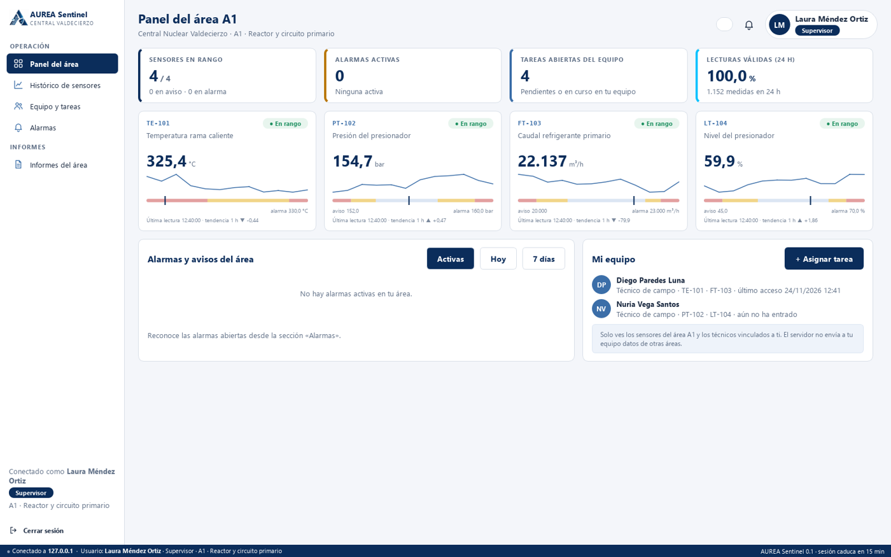
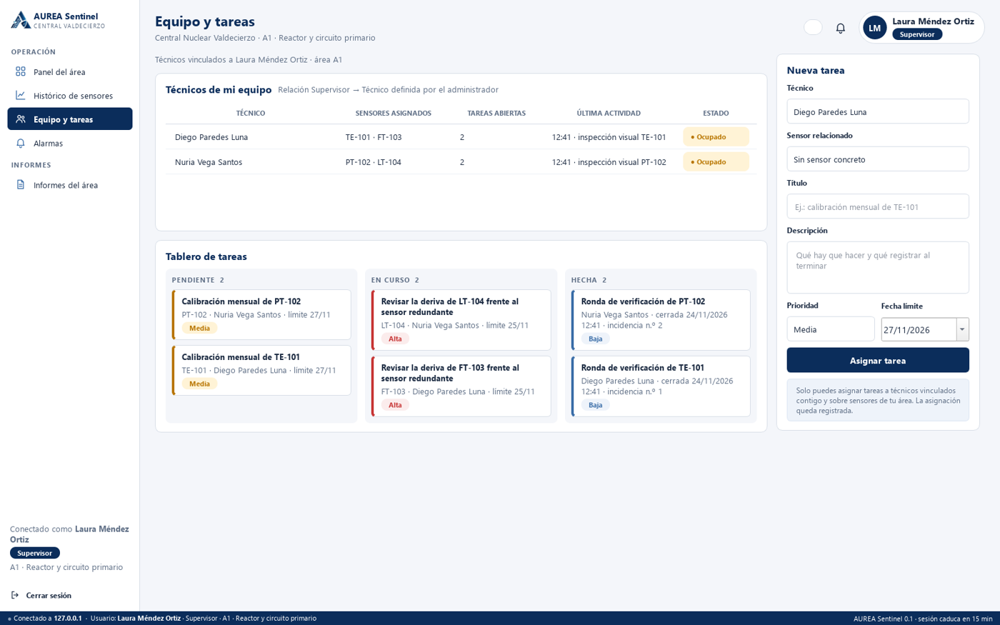
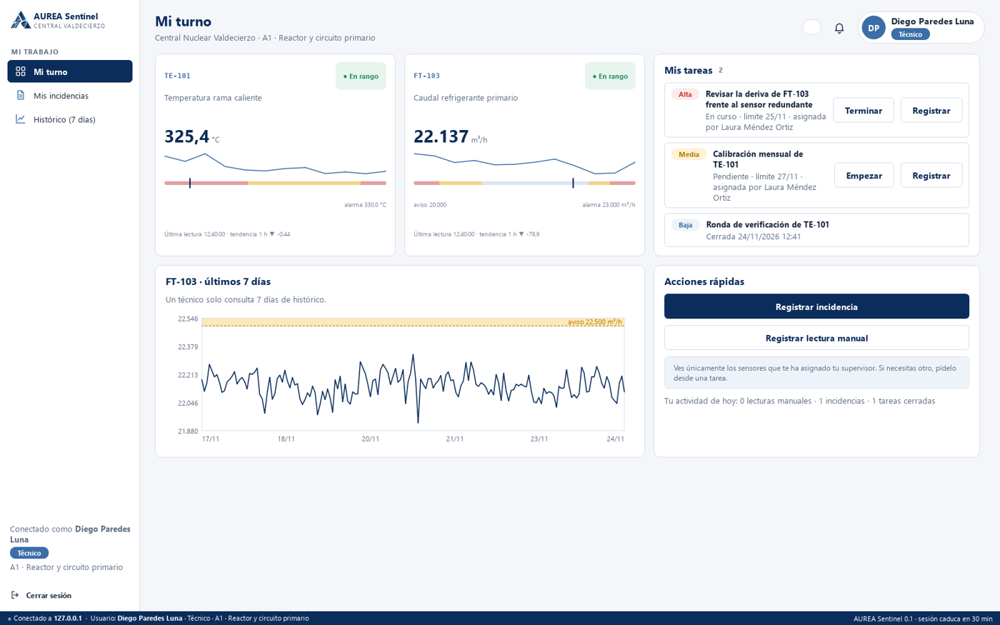
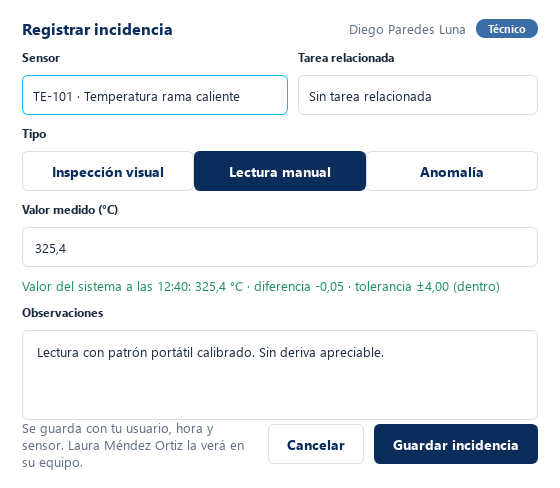

# AUREA Sentinel · Manual de usuario (borrador)

Borrador del Sprint 3 (T18). Explica, rol por rol, lo que ya se puede hacer en la aplicación. Las ventanas del Auditor y del Administrador llegan en el Sprint 4 (T19) y este manual se completará entonces (T20).

---

## 1. Antes de empezar

**Qué es.** AUREA Sentinel supervisa los 36 sensores de la Central Nuclear Valdecierzo (ficticia), repartidos en 9 áreas. Cada persona ve solo lo que le corresponde según su rol y su área.

**Cómo se abre.** Doble clic en `AUREA Sentinel.exe`. No hay que instalar nada ni hace falta internet. La primera vez tarda unos segundos: prepara la base de datos con las cuentas de demostración, 30 días de lecturas y algunas tareas de ejemplo. Si Windows avisa («Windows protegió su PC»), pulsa **Más información → Ejecutar de todas formas**.

**Cuentas de demostración.** Correo `nombre.apellido@cn-valdecierzo.es` (sin tildes). Contraseña de todas: `Valdecierzo-2026!`

| Rol | Ejemplo | Qué ve |
|---|---|---|
| Supervisor | `laura.mendez@cn-valdecierzo.es` (área A1) | Su área, su equipo y sus tareas |
| Técnico | `diego.paredes@cn-valdecierzo.es` (depende de Laura) | Solo los sensores que le han asignado y sus tareas |
| Auditor | `beatriz.lara@cn-valdecierzo.es` | Datos agregados y el registro de auditoría (Sprint 4) |
| Administrador | `alvaro.campos@cn-valdecierzo.es` | Cuentas, sensores y umbrales (Sprint 4) |

**En todas las ventanas** se ve arriba a la derecha **quién eres y tu rol**, y abajo, en la barra azul, tu usuario, tu área y cuánto falta para que caduque la sesión.

---

## 2. Entrar en la aplicación

1. Escribe tu **correo** y tu **contraseña** y pulsa **Iniciar sesión**. El icono del ojo enseña la contraseña. Marca **Equipo compartido** si el ordenador lo usan más personas: así no se recuerda tu correo.
2. **Supervisor, Auditor y Administrador** tienen un segundo paso:
   - **La primera vez** aparece un **código QR**. Escanéalo con una aplicación autenticadora del móvil (Google Authenticator, Microsoft Authenticator, Aegis…) y escribe el código de 6 dígitos que te muestra.
   - **Los demás días** solo escribes el código que te enseña la aplicación del móvil.
   - Tienes 5 minutos y 3 intentos; un código no vale dos veces.
3. El **Técnico** entra solo con la contraseña.

**Si algo falla** el mensaje es siempre el mismo, para no dar pistas a nadie. Tras **5 fallos seguidos** la cuenta se bloquea **15 minutos**.

**La sesión caduca sola** (Supervisor y Auditor 15 min, Técnico 30 min, Administrador 10 min) y vuelve a la pantalla de acceso. Para salir antes, **Cerrar sesión** en el pie del menú.

**¿No tienes cuenta?** En la pantalla de acceso, **Registrarse**. La cuenta queda **pendiente** hasta que el Administrador la apruebe.

---

## 3. Supervisor

### 3.1 Panel del área

- **Cuatro indicadores**: sensores en rango, alarmas activas, **tareas abiertas de tu equipo** y lecturas válidas de las últimas 24 h.
- **Una tarjeta por sensor** de tu área con su valor, su estado (En rango, Aviso o Alarma, siempre también en texto), la tendencia de la última hora y la barra de umbrales. Se actualiza sola cada 5 segundos.
- **Pulsa una tarjeta** para abrir su histórico.
- **Alarmas y avisos del área** (Activas, Hoy, 7 días) y **Mi equipo**. El botón **+ Asignar tarea** lleva a «Equipo y tareas».

### 3.2 Histórico de sensores

Elige el sensor y el periodo (24 horas, 7 días, 30 días o fechas propias). Puedes **comparar** con otro sensor de la misma unidad. Verás mínimo, máximo y media, la gráfica con los umbrales y la tabla por horas. **Exportar CSV** guarda los datos en un archivo que abre Excel; cada exportación queda en el registro de auditoría.

### 3.3 Equipo y tareas

- **Técnicos de mi equipo**: los sensores que tiene asignados cada uno, sus tareas abiertas, su última actividad y si está **Disponible** u **Ocupado** (tiene alguna tarea en curso).
- **Tablero de tareas** en tres columnas: **Pendiente**, **En curso** y **Hecha**. La prioridad se ve por el color del borde y por texto (Alta, Media, Baja). En «Hecha» aparece la fecha de cierre y la incidencia asociada.
- **Nueva tarea** (a la derecha):
  1. Elige el **técnico** (solo aparecen los tuyos) y, si quieres, el **sensor** (solo los de tu área).
  2. Escribe un **título** y, si hace falta, una **descripción**.
  3. Elige la **prioridad** y la **fecha límite** (no puede ser anterior a hoy).
  4. Pulsa **Asignar tarea**. La tarea aparece en el tablero y en el turno del técnico, y queda registrada.

### 3.4 Alarmas

Lista de alarmas de tu área con el mismo filtro que el panel. En las que siguen **abiertas** aparece el botón **Reconocer**: indica que la has visto y la estás atendiendo. La alarma **se cierra sola** cuando el valor vuelve al rango. Si hace falta que alguien vaya a revisarla, crea una tarea desde «Equipo y tareas».

---

## 4. Técnico

### 4.1 Mi turno

- Si uno de tus sensores entra en **aviso o alarma**, aparece una **franja amarilla** arriba con el botón **Ver sensor**.
- **Tus sensores**: solo los que te ha asignado tu supervisor, con su valor, su estado y sus umbrales. Pulsa uno para ver su histórico.
- **Mis tareas**: prioridad, fecha límite y quién te la asignó.
  - **Empezar** la pasa a «En curso» y **Terminar**, a «Hecha».
  - **Registrar** abre el registro de incidencia con esa tarea ya elegida.
- **Gráfica de 7 días** de uno de tus sensores (un técnico consulta como mucho 7 días).
- **Acciones rápidas**: **Registrar incidencia** y **Registrar lectura manual**, y el resumen de tu actividad de hoy.

### 4.2 Registrar una incidencia o una lectura manual

1. Comprueba el **sensor** y la **tarea relacionada** (vienen ya elegidos si entras desde una tarea).
2. Elige el **tipo**: **Inspección visual**, **Lectura manual** o **Anomalía**.
3. En una **lectura manual** escribe el **valor medido** (con coma o con punto). Debajo verás el valor del sistema, la diferencia y si está **dentro de la tolerancia** (±1 % del rango del sensor).
4. Escribe las **observaciones** y pulsa **Guardar incidencia**.

La aplicación comprueba los datos antes de enviarlos y el servidor los vuelve a comprobar: un valor fuera del rango físico del sensor no se guarda. La incidencia queda ligada al **sensor**, a la **tarea**, a **ti** y a tu **supervisor**, que la ve en «Equipo y tareas».

### 4.3 Mis incidencias e Histórico (7 días)

- **Mis incidencias**: todo lo que has registrado, lo más reciente primero, con el botón para registrar otra.
- **Histórico (7 días)**: el histórico de tus sensores, como el del Supervisor pero limitado a 7 días y sin exportar a CSV.

---

## 5. Auditor (Sprint 4)

La ventana del Auditor llega en el Sprint 4 (T19). Lo que hará ya funciona en el servidor y está probado (T16 y T18):

- **Consultar el registro de auditoría** completo, con los nombres ocultos («Usuario n.º 12 · Supervisor»).
- **Verificar la cadena**: cada evento guarda la huella del anterior; si alguien cambia o borra un evento, la verificación dice cuál.
- **Exportar a CSV firmado** e indicar si la cadena está íntegra. La firma permite comprobar después que nadie ha tocado el archivo, y cada exportación queda, a su vez, en el registro.
- **Ver las incidencias** de toda la central en solo lectura y sin nombres.

---

## 6. Administrador (Sprint 4)

La ventana del Administrador llega en el Sprint 4 (T19): aprobar, bloquear y editar cuentas, asignar técnicos a supervisores y gestionar sensores y umbrales. Mientras tanto, el Administrador ya puede consultar **sus propios eventos** del registro de auditoría desde el servidor.

---

## 7. Problemas frecuentes

| Qué pasa | Qué hacer |
|---|---|
| «Correo o contraseña incorrectos, o cuenta no disponible» | Revisa el correo (sin tildes) y la contraseña. Si fallas 5 veces, espera 15 minutos. Si acabas de registrarte, la cuenta está pendiente de aprobación |
| El código de 6 dígitos no vale | Comprueba que la hora del móvil es automática. Escribe el código que se ve en ese momento, no uno anterior |
| «No tienes permiso para esta operación» | Estás intentando ver o cambiar algo que no es de tu área o de tu equipo. Es el comportamiento esperado |
| No me salen sensores en «Mi turno» | Tu supervisor todavía no te ha asignado sensores |
| «No se puede conectar con el servidor» | Cierra la aplicación y vuelve a abrirla. Todo funciona en tu equipo, sin red |
| La sesión se cierra sola | Ha caducado por inactividad. Vuelve a entrar |
